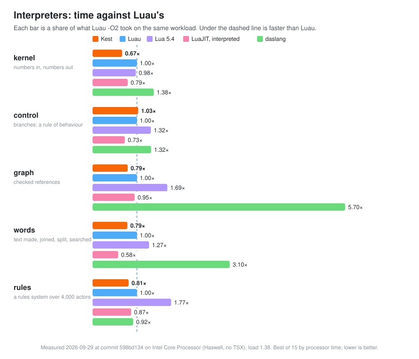
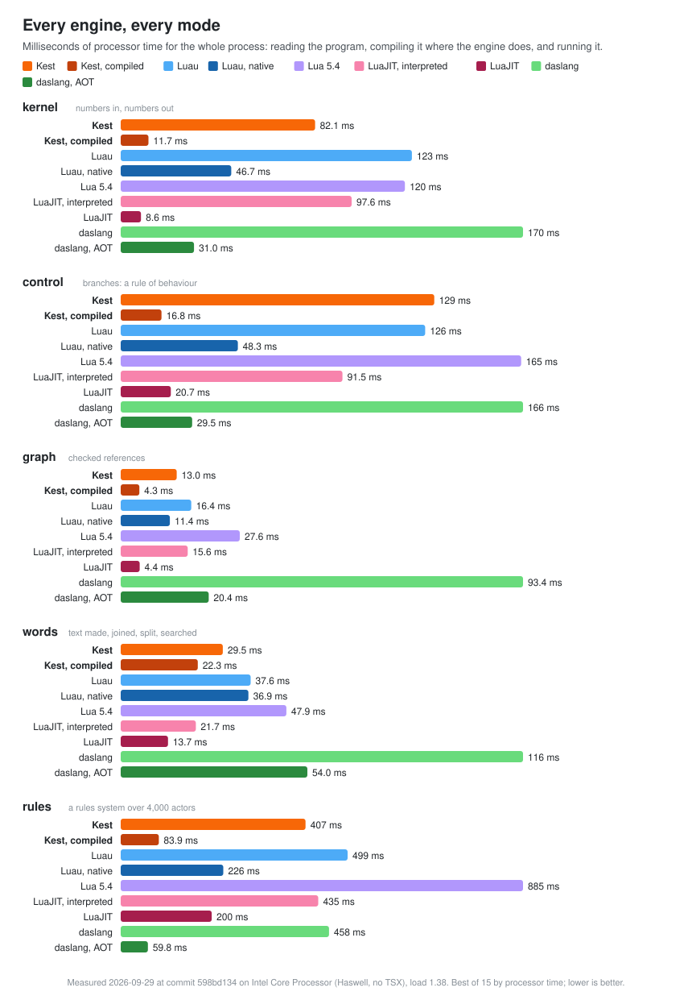
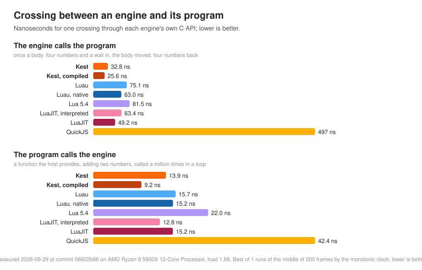
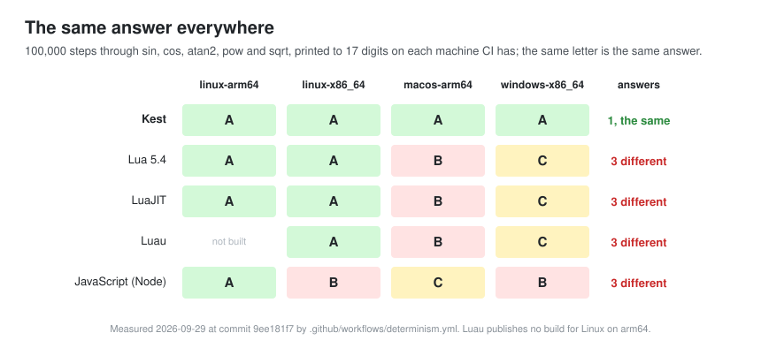

# Kest

A small, fast, statically typed language for the gameplay half of a game, run by a bytecode machine a native engine embeds.

[](https://github.com/Rawframe-Project/kest/actions/workflows/ci.yml)
[](LICENSE)
[](https://github.com/Rawframe-Project/kest/releases)
[](https://scorecard.dev/viewer/?uri=github.com/Rawframe-Project/kest)

Kest sits where Luau, daslang, Lua and AngelScript sit: inside an engine, running the rules, the AI, the quests and the simulation a designer changes every day. It is one C11 library with nothing beneath it but libc, and a compiler that proves what the code promises before it runs.

```kest
module quest

import std.io

enum Task {
    Idle
    Fetch(i32)
    Wait(i32)
}

struct Actor {
    name: text
    hp: i32
    task: Task
}

// The compiler proves both promises: nothing here touches the heap, and
// it answers the same on every machine.
fn next(one: Actor) -> Task no.alloc deterministic {
    return match one.task {
        Idle -> if one.hp < 50 -> Task.Wait(3) else -> Task.Fetch(1)
        Fetch(item) -> Task.Wait(item + 1)
        Wait(left) -> if left <= 1 -> Task.Idle else -> Task.Wait(left - 1)
    }
}

fn main() -> i32 {
    let world: store<Actor> = store(16)
    let hero = add(world, Actor("Ada", 80, Task.Idle))
    for turn in 0..5 {
        if let one = get(world, hero) {
            one.task = next(one)
            set(world, hero, one)
            io.print("turn {turn}: {one.name} is {one.task}")
        }
    }
    return 0
}
```

```text
turn 0: Ada is Task.Fetch(1)
turn 1: Ada is Task.Wait(2)
turn 2: Ada is Task.Wait(1)
turn 3: Ada is Task.Idle
turn 4: Ada is Task.Fetch(1)
```

## Why Kest

- **Fast where a frame is spent.** A stack machine with fused instructions, and a second engine that writes the program as C for a release build.
- **Promises the compiler proves.** `no.alloc`: the body never touches the heap. `no.host`: it never calls into the engine. `deterministic`: it computes the same bits on every machine, for lockstep, rollback and replays. Each is checked over every body a function reaches.
- **Identity that cannot dangle.** `store<T>` hands out `ref<T>`, and a reference to something removed is refused at the line that used it instead of reading whatever took its place.
- **Diagnostics for people and tools.** Every mistake in a file in one pass, each with a stable code, the place and a fix where one is known, and `--json` for editors and agents.
- **Made to be embedded.** One header and one static library, no allocator or thread the host did not hand it, and ceilings on stack, call depth, heap and steps that are refused in words.
- **Reload while the game runs.** A changed program is rebuilt under the world the host holds, or refused with the old one untouched.

## Quick start

From the source, with a C compiler and `make`:

```sh
git clone https://github.com/Rawframe-Project/kest.git
cd kest
make
./kest run examples/math.kest
./kest new game && cd game && ../kest run
```

On Windows, run `tools\build.bat` from a Developer Command Prompt and use `build\win\kest.exe`. Each release on the [releases page](https://github.com/Rawframe-Project/kest/releases) has an archive for every platform below, checksummed in `SHA256SUMS` and attested; unpack it anywhere and put its `bin` on the path. The [playground](https://rawframe-project.github.io/kest/) runs the command line in the browser.

A host builds a program, starts a machine and calls into it:

```c
#include <kest.h>

KestBuild *build = kest_build("rules.kest", NULL, stderr, KEST_FORM_TEXT, 0);
KestRuntime *vm = build ? kest_start(build, NULL, NULL) : NULL;
int32_t damage = kest_entry(vm, "damage");
KestValue frame[4] = {{.integer = 80}, {.integer = 25}, {.integer = 5}};
kest_call(vm, damage, frame, 4); // frame[0] holds the answer
```

[Getting started](docs/user/getting-started.md) and [Embedding](docs/user/embedding.md) go through both.

## Platforms

Linux on x86-64 and arm64 with GCC or Clang, macOS on arm64, Windows on x86-64 with MSVC, and WebAssembly (WASI). CI builds and runs every example on the first four and holds them to the same output byte for byte.

## Performance

Measured on one 8-processor machine against Luau, Lua 5.4, LuaJIT, QuickJS-ng and daslang. Kest's interpreter is ahead of Luau's on all five workloads, and its release engine ahead of Luau's native code on all five; a host calling into Kest is cheaper than into any other engine measured. [Performance](docs/internals/performance.md) has the rest and what it does not win, and [Benchmarks](docs/operations/benchmarks.md) says how to take the numbers again.

<p align="center">
  
</p>
<p align="center">
  
</p>
<p align="center">
  
</p>
<p align="center">
  
</p>

## Status

Before 1.0.0 nothing is frozen: a release can change the language, and the [changelog](CHANGELOG.md) says what a program has to do about it. It is not a systems language, an engine or a hard real-time system. It is being built into a sandbox for code nobody trusts, and [Running untrusted code](docs/user/untrusted-code.md) says how far each promise is kept today and how to report a vulnerability.

## Documentation

- [The documentation site](https://rawframe-project.github.io/kest/docs/), with the standard library reference, and [llms.txt](https://rawframe-project.github.io/kest/llms.txt) and [llms-full.txt](https://rawframe-project.github.io/kest/llms-full.txt) for a model.
- [Documentation index](docs/README.md): using the language, embedding it, and how it works.
- [Getting started](docs/user/getting-started.md) and [Coming from Lua or Rust](docs/user/coming-from-lua-or-rust.md).
- [How it works](docs/internals/overview.md) and [how to develop it](docs/operations/development.md).
- [Changelog](CHANGELOG.md).

## Contributing

Issues are welcome. Pull requests are accepted for issues a maintainer has approved; see [CONTRIBUTING.md](https://github.com/Rawframe-Project/.github/blob/main/CONTRIBUTING.md). The project is developed with AI coding agents, directed and reviewed by its maintainers; outside contributions follow the [AI policy](https://github.com/Rawframe-Project/.github/blob/main/AI_POLICY.md).

## License

MIT; see [LICENSE](LICENSE). `bench/hosts/tetromino.lua` is a copy of a third party's game under its author's MIT license, which the file carries.
